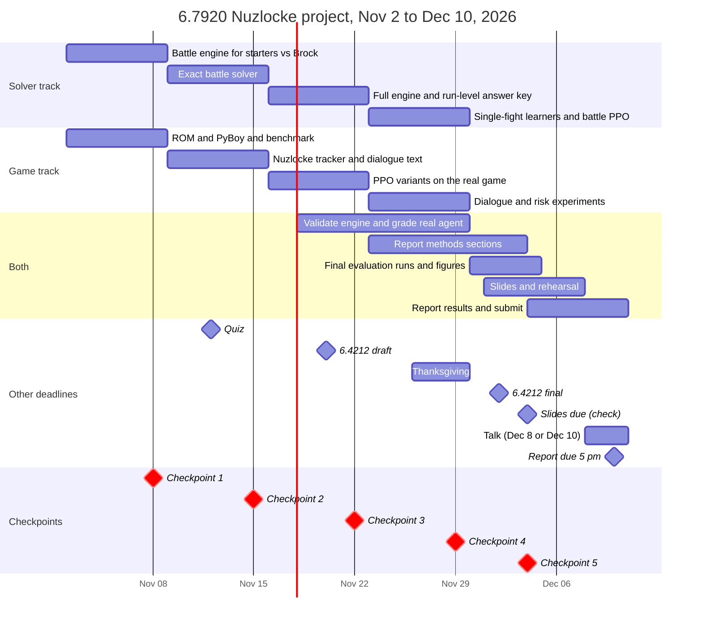

# Project timeline: Nov 2 to Dec 10, 2026

Plan for our 6.7920 project, *Gotta Remember 'Em All: Hidden State and Rule Following in a Pokémon Nuzlocke*.
We work in two parallel tracks and hold a 30-minute sync every Sunday to check that week's checkpoint. The plan
budgets about 120 hours in total, roughly 60 each, which is about 10 hours per person per week.

> **Blocker for the game track:** everything in the real game needs a ROM dumped from a Pokémon Red cartridge we
> own, using a USB cartridge reader. Order a reader right away if we don't have one. The solver track doesn't need
> the ROM, so it can start regardless.

## Key dates

- **Thu Nov 12:** 6.7920 quiz
- **Fri Nov 20:** 6.4212 draft (Jeffrey)
- **Thu Nov 26 to Sun Nov 29:** Thanksgiving
- **Wed Dec 2:** 6.4212 final (Jeffrey)
- **Fri Dec 4:** slides possibly due (check)
- **Tue Dec 8 or Thu Dec 10:** talk, at most 10 minutes
- **Thu Dec 10, 5 pm:** report due (at most 5 pages plus a 10-page appendix)

## Who does what

- **Solver track (Jeffrey, suggested):** battle engine, exact answers (battle and run level), single-fight learners.
  This work pauses easily around the 6.4212 deadlines.
- **Game track (Kevin, suggested):** the real game in PyBoy, Nuzlocke rule tracking, dialogue reading, PPO training.
  Training runs need someone checking on them daily.

Swap if we prefer.

## Timeline

## Checkpoints and fallbacks

| Checkpoint | Must be true | If it slips |
|---|---|---|
| **Sun Nov 8** | The engine gives exact turn-outcome distributions for Brock vs. each starter, matching Smogon's calculator. The game environment runs headless on ORCD. | Solver: narrow to Charmander vs. Brock to unblock the solver. Game: if the ROM hasn't arrived, help on the engine and start the real game when it does. |
| **Sun Nov 15** | Exact full-information and perfect-memory optima for each starter vs. Brock. The Nuzlocke tracker and dialogue text work, and the first Nuzlocke PPO run is going. | Ship the full-information optimum first and limit the memory version to Bide's hidden length. |
| **Sun Nov 22** | Run-level answer key: optimal Pr(beat Brock) per starter and encounter draw. First real-game Nuzlocke results. | Use the proposal's fallback: the gym alone (a trainer and Brock, team from first encounters). If PPO can't reach Brock, start episodes from a save state after Viridian Forest. |
| **Sun Nov 29** | Every experiment has run at least once. | Cut from the list below. No new experiment types after this date. |
| **Fri Dec 4** | Slides and the four core figures are final. | Present what's done; unfinished experiments become future work in the report. |

## Week by week

### Week 1 · Nov 2–8 · Foundations

Checkpoint: Sun Nov 8.

**Both**
- [ ] Shared repo and Python environment; confirm ORCD access and ask for CPU cores for emulators.
- [ ] One-hour kickoff to fix the interfaces: the engine's `outcomes(state, action)` returning (probability, next
      state) pairs, the run model's macro actions, the Gymnasium environment and the log format.
- [ ] Get the ROM dumped from our own cartridge; order a reader if needed.

**Solver track**
- [ ] Gen 1 damage formula, critical hits, accuracy and stat stages.
- [ ] Moves for the three starters and Brock's Geodude and Onix (about 11, including Bide), and Brock's AI with his
      Full Heals.
- [ ] Enumerate every turn outcome with its probability; unit tests against Smogon's damage calculator.

**Game track**
- [ ] PyBoy headless, plus a fork of an existing Pokémon Red environment
      ([Whidden's v2](https://github.com/PWhiddy/PokemonRedExperiments) already reaches Cerulean).
- [ ] Benchmark emulator steps per second on a laptop and an ORCD node, to size every later run.
- [ ] Memory readers for party, map and battle state using
      [pret/pokered](https://github.com/pret/pokered)'s symbol names; a smoke-test PPO run without Nuzlocke rules.

### Week 2 · Nov 9–15 · Quiz week

Quiz Thu Nov 12; light until then, with most of the week's work Friday to Sunday. Checkpoint: Sun Nov 15.

**Solver track**
- [ ] Full-information optimum by DP over the reachable battle states.
- [ ] Perfect-memory optimum as a belief MDP over Bide's hidden length and unseen stat stages.
- [ ] Check both against Monte Carlo runs with Hoeffding intervals.

**Game track**
- [ ] Nuzlocke tracker: a fainted Pokémon stays dead even after a Pokémon Center heal; first encounter per area; a
      wipe ends the episode; level cap 14; no items in battle; set mode.
- [ ] Dialogue text: decode the on-screen text box from the tile map with pret's character map.
- [ ] Embed each unique line once with a frozen sentence encoder and cache it; launch the first Nuzlocke PPO run
      (memoryless).

### Week 3 · Nov 16–22 · Answer key and first real results

6.4212 draft due Fri Nov 20. Checkpoint: Sun Nov 22.

**Solver track**
- [ ] Extend the engine to everything before Brock: 15 species, 25 moves, 17 move effects; the Bug Catchers, the
      Jr. Trainer and the rival.
- [ ] Fight-outcome tables feed the run-level SSP; value and policy iteration give optimal Pr(beat Brock) per starter
      and encounter draw.
- [ ] Discounted vs. undiscounted optimal policies (H3).

**Game track**
- [ ] PPO on the real game in three versions: memoryless, LSTM, and LSTM with dialogue embeddings; 2–3 seeds each if
      throughput allows.
- [ ] Rewards: exploration, milestones (Oak's Parcel, Pokédex, Viridian Forest, Pewter City, Brock) and a bonus for
      new dialogue.
- [ ] Log deaths, rule violations and milestones for every episode.

**Both**
- [ ] Validate the engine against about 100 staged Brock fights in the emulator, from a save state before the gym.
- [ ] Grade the real agent's macro decisions (what it caught, its levels at Brock, when it challenged) inside the run
      model.

### Week 4 · Nov 23–29 · Experiments

Thanksgiving Thu Nov 26: front-load Monday to Wednesday and queue long training runs before leaving.
Checkpoint: Sun Nov 29.

**Solver track**
- [ ] On the exact Brock fight: tabular Q-learning, TD(λ), DQN vs. Double DQN and MCTS, plus random, greedy
      max-damage and heuristic baselines.
- [ ] PPO memoryless vs. LSTM on the battle POMDP, with linear probes for Bide's timing (H1).
- [ ] Starter choice as a bandit: UCB vs. the exact best starter.

**Game track**
- [ ] Dialogue ablation (H2): with vs. without text, measuring Pokémon Center heals, accidental PC releases and time
      to finish Oak's Parcel.
- [ ] Risk sweep (H3): γ = 0.99, 0.997 and 0.999, and the size of the death penalty.
- [ ] Long runs over the break.

**Both**
- [ ] Start the report's methods sections while the setup is fresh.

### Week 5 · Nov 30–Dec 6 · Analysis and talk

6.4212 final due Wed Dec 2; slides possibly due Fri Dec 4. Checkpoint: Fri Dec 4.

**Both**
- [ ] Final evaluation runs with 95% confidence intervals.
- [ ] Four core figures: optimality gaps against the exact answers, the memory ablation, the dialogue ablation, and
      discounting vs. risk.
- [ ] Slides drafted by Thu Dec 3 and rehearsed to under 10 minutes; check whether slides are due Fri Dec 4.
- [ ] Draft the report's results sections.

### Week 6 · Dec 7–10 · Talk and report

**Both**
- [ ] Talk on Tue Dec 8 or Thu Dec 10, at most 10 minutes.
- [ ] Report: full draft Mon Dec 7, polish Tuesday and Wednesday, submit Thursday morning (due 5 pm).

## Planned hours per week

| Week | Jeffrey (solver) | Kevin (game) | Notes |
|---|---:|---:|---|
| Nov 2–8 | 11 | 10 | |
| Nov 9–15 | 7 | 7 | Quiz Thu Nov 12 |
| Nov 16–22 | 7 | 13 | 6.4212 draft Fri Nov 20 |
| Nov 23–29 | 12 | 9 | Thanksgiving Thu Nov 26 |
| Nov 30–Dec 6 | 8 | 12 | 6.4212 final Wed Dec 2 |
| Dec 7–10 | 14 | 12 | Talk and report |
| **Total** | **59** | **63** | about 120 h |

This is the optimistic end of the estimate, so cut as soon as a checkpoint slips.

## If we fall behind, cut in this order

1. LLM-labeled dialogue rewards (keep the cached sentence encoder).
2. TD(λ) (keep tabular Q-learning).
3. Seeds beyond two per real-game version.
4. Level-cap variants of the answer key.
5. Full-route real-game training: start episodes after Viridian Forest instead.

Misty's gym and the LLM baseline stay out unless everything else is done by Nov 29.

## Changes from the submitted proposal

- Engine unit tests land Sun Nov 8, not Nov 6.
- "Exact solves by Nov 15" splits in two: battle solves by Nov 15, and the run-level answer key by Nov 22, because it
  needs the full engine.
- No LLM calls at every step. The original GPT-3 models were retired from OpenAI's API in January 2024, and any LLM is
  far too slow inside an RL loop. Pokémon Red's dialogue is a finite set of lines, so we embed each line once with a
  frozen sentence encoder (for example all-MiniLM-L6-v2) and cache it. If we want an LLM, a small open model run
  offline on our H100 can label which lines point to a place (Pokémon Center, Poké Mart, Oak's lab), and those labels
  become rewards.
- The 3,000-run confidence intervals apply to the engine and run model, where runs are cheap. Real-game evaluation
  will use a few hundred episodes, with wider intervals.
- The answer key covers the run model's macro decisions, so the real-game agent is graded on its decisions inside that
  model. The gap is approximate, because the run model heals the team between fights.
