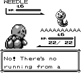

# Corrected/recovery campaign and Viridian Forest diagnosis

The metadata snapshot was collected on November 23, 2026 at 20:29 UTC (3:29 p.m.
Eastern). It includes `campaign-coherent-20261122` and its continuation,
`campaign-recovery-20261123`. It excludes the pre-fix November 22 results.
The old corrected campaign's archived `running` status is not a live process.

## Campaign evidence

There are **146 completed evaluation episodes: 53 reached Viridian Forest, zero
reached Pewter City, and zero defeated Brock**. Endings are 80 timeouts, 25 wipes,
and 41 rule violations; all 41 violations are `illegal_catch`. Among the 53 episodes
that reached the forest, 31 time out, 16 wipe, and six violate the catch rule.
These are repeated checkpoint evaluations, not 146 independent training seeds.

All twelve configurations have completed the 5,242,880-action stage:

| Inputs | Policy | Training seeds evaluated | Forest / evaluation episodes | Pewter / Brock |
|---|---|---:|---:|---:|
| pixels | PPO | 3 | 6 / 15 | 0 / 0 |
| pixels | LSTM | 3 | 6 / 15 | 0 / 0 |
| RAM | PPO | 3 | 9 / 15 | 0 / 0 |
| RAM | LSTM | 3 | 10 / 15 | 0 / 0 |

The 10,485,760-action stage is incomplete. There is no established architecture
winner. The snapshot also contains 7,297 completed training episodes, of which
3,286 reached the forest and none reached Pewter/Brock. Training episodes are not
held-out evaluation evidence.

Files: [progress](progress.json), [individual evaluations](evaluations.json),
[training summaries](training.json), [manifests](manifests.json), and
[queue snapshots](queue_status.json). Keys retain the campaign and run names.
The recovery queue had 16 completed jobs, one running, and 13 pending; the archived
campaign contributed 42 completed jobs. The active job was `pixels-lstm-s1-m10-train`.

## Confirmed forest failure modes

**Seventeen diagnostic replays across three training-seed-0, 10.49M-action checkpoints reproduced
the original episode length, ending, final position, death count and return.** Ten
of these episodes reached the forest. Across the 17 probes there were six wipes,
seven illegal-catch terminations and four timeouts. Eight individual Pokémon fainted:
**four during trainer battles, three from poison while walking, and one during a
wild battle**. Two of those faints belonged to a surviving multi-member team, so
faint counts must not be confused with wipe counts.

The game executed **198 rejected trainer RUN attempts across three episodes**.
It also recorded 264 successful wild escapes and 12 failed wild RUN attempts
across the full probes (including encounters before the forest). This confirms
that escaping wild encounters is learned in many situations, but not a reliable
complete survival policy.

Concrete examples:

- `pixels-ppo-s0-m10`, evaluation seed 1000: enters the forest at action 4,704
  with one level-6 starter at 19/22 HP. After 21 forest wild encounters it enters
  a trainer fight at action 9,958 with **3/22 HP and poison**, then wipes at action
  10,033. **No trainer RUN attempt** occurs in this episode.
- The same checkpoint, seed 1001: enters healthy at action 6,322. It makes
  **44 rejected RUN attempts in the first trainer battle and 78 in the second**,
  then wipes at action 14,609. Trainer battles consume about 78% of its forest
  emulator time; that includes fighting/menu time, not just RUN rejections.
- The same checkpoint, seed 1002, and RAM PPO seed 1005: both die from walking
  poison **without entering a trainer battle**. The RAM LSTM seed-1005 episode
  also loses a member to walking poison, another in a trainer battle, and times
  out with a third member still alive.
- RAM PPO seeds 1001 and 1002 time out alive after **25 and 35 forest wild
  encounters**, respectively, without any trainer battle. Battles occupy about
  29% of their forest time; movement/menu behavior outside battle also needs work.
- RAM LSTM seed 1005 only reaches the forest at action **11,668 of 16,384**,
  spends about 88% of its forest time in battles, and finishes its second trainer
  battle at action 16,347. Extra episode budget could help this particular case,
  but it would not fix the poison deaths or failed trainer RUN choices.



Per-episode forest telemetry follows. `Wild/1k` divides encounters by **all forest
policy actions**, including battles and menus. This varies with dwell time and is
not a pure per-step grass encounter probability. `Battle %` uses emulator-frame
counts. The seven probes that never reach the forest are retained in the JSON.

| Checkpoint | Eval seed | First forest action | Forest actions | Wild battles | Wild/1k | Trainers | Rejected RUN | Battle % | Ending / faints |
|---|---:|---:|---:|---:|---:|---:|---:|---:|---|
| pixels-ppo-s0-m10 | 1000 | 4,704 | 5,242 | 21 | 4.01 | 1 | 0 | 45.4% | wipe / trainer_battle |
| pixels-ppo-s0-m10 | 1001 | 6,322 | 7,665 | 3 | 0.39 | 2 | 122 | 80.9% | wipe / trainer_battle |
| pixels-ppo-s0-m10 | 1002 | 6,561 | 2,577 | 5 | 1.94 | 0 | 0 | 15.0% | wipe / overworld_poison |
| pixels-ppo-s0-m10 | 1003 | 5,220 | 3,495 | 1 | 0.29 | 2 | 38 | 80.1% | wipe / trainer_battle |
| pixels-ppo-s0-m10 | 1004 | 14,225 | 1,443 | 5 | 3.47 | 0 | 0 | 32.1% | wipe / wild_battle |
| ram-lstm-s0-m10 | 1002 | 4,308 | 3,569 | 11 | 3.08 | 0 | 0 | 61.0% | rule_violation / none |
| ram-lstm-s0-m10 | 1005 | 11,668 | 4,712 | 4 | 0.85 | 2 | 38 | 87.6% | time_limit / overworld_poison, trainer_battle |
| ram-ppo-s0-m10 | 1001 | 6,561 | 9,824 | 25 | 2.54 | 0 | 0 | 28.6% | time_limit / none |
| ram-ppo-s0-m10 | 1002 | 4,426 | 11,952 | 35 | 2.93 | 0 | 0 | 29.6% | time_limit / none |
| ram-ppo-s0-m10 | 1005 | 9,363 | 3,444 | 5 | 1.45 | 0 | 0 | 31.5% | wipe / overworld_poison |

See the [compact diagnostic overview](forest/overview.json) and full summaries for
[pixel PPO](forest/pixels-ppo-s0-m10.json), [RAM PPO](forest/ram-ppo-s0-m10.json),
and [RAM LSTM](forest/ram-lstm-s0-m10.json). The
[diagnostic release](https://github.com/Phronesis618/67920project/releases/tag/forest-diagnostics-2026-11-23)
contains three videos and all 17 compressed action/event traces. These traces are
**replays of existing evaluations**, not 17 additional independent evaluation trials.

## Diagnostic method

`scripts/diagnose_forest.py` replays frozen checkpoints with their original
configuration, starting save, stochastic action selection, CUDA device, and seed
sequence. It records position, battle type, party HP/level/status, action and reward
every action, plus battle transitions, HP/status changes and faints every emulator
frame. It counts actual executions of the game's RUN routines, including trainer
rejections, failed wild escapes and successful escapes. Pressing B is not treated
as evidence of selecting RUN.

Hooks are restricted to ROM SHA-1 `ea9bcae617fdf159b045185467ae58b2e4a48b9a` and
checked instruction bytes. Their semantics come from the pinned
[TryRunningFromBattle implementation](https://github.com/pret/pokered/blob/ba9c0568f64ae602fadda577a08c66639f93082a/engine/battle/core.asm#L1483).
Walking-poison classification uses a positive-to-zero HP transition outside battle
with poison present before the transition; see
[the overworld poison routine](https://github.com/pret/pokered/blob/ba9c0568f64ae602fadda577a08c66639f93082a/engine/events/poison.asm).
For faints during battles, the trace identifies wild versus trainer context; it
does not separate attack damage from in-battle poison damage.

The selected checkpoint probes target known failures and timeouts. They are a
diagnosis sample, not an unbiased estimate of all policies' failure frequencies.
Videos start on first forest arrival and retain subsequent actions even if the
agent leaves the forest. One frame per action at 10 fps is about four times game
speed. The wild-encounter rate denominator includes all actions in the forest,
including battle/menu time; frame counts also permit overworld-only comparisons.

## Input audit and proposed next experiment

The gradual removal of privileged policy inputs is already represented by the
matched `pixels` versus RAM-assisted conditions:

| Actual condition | Actor inputs | Privilege |
|---|---|---|
| `pixels`, PPO and LSTM | Three grayscale screens and three recent actions | No RAM observations or exploration map |
| `partial` (the current RAM runs) | Screens/actions, aggregate health/level, badges, events, exploration map, per-member HP/level/presence/status | RAM-assisted; not full game state |
| `history` (not in this campaign) | `partial` plus dead-member and used-region history | Additional monitor-derived history |

The flow chart needs two corrections. The current exploration map, encounter-region
history and tile-based exploration/stuck rewards use RAM coordinates or battle
monitoring; they are privileged in this implementation. They would only become
nonprivileged if reconstructed from the allowed visual/action history. Also,
current RAM observations still omit information such as enemy stats and explicit
battle type; recurrence can help even in that condition.

Both pixel and RAM conditions share privileged **training rewards**. This is
separate from supplying privileged **actor inputs**. The active reward coefficients
are +2 per increase in the event-count maximum, +5 per badge, +0.00125 per new tile,
and `5 * (increase in total HP fraction)^2` for qualifying healing. A single jump
from 50% to 100% HP gives +1.25; several smaller increments give a different sum.
The stuck term changes the state score by -0.025 when a tile's visit count reaches
600, with an offset when leaving that state; it is not a penalty on every revisit.
Path shaping is `gamma * Phi(next) - Phi(current)` with quest-conditioned distance,
not a flat +3 bonus. The death/violation penalty coefficients are currently zero;
these events still terminate an episode and receive the terminal potential change.

The shortest-path reward supplies a static distance heuristic. It does not choose
the buttons or account for trainer risk, encounter delays, poison or healing.
Reaching a low-HP state deep in the forest may already be too late to walk back
alive. Any healing experiment should include poison/cure behavior and should
evaluate actual survival and progress, not repeated healing reward alone.

The next controlled experiment should isolate battle/survival behavior from a
legal forest-entry or trainer-approach save, with the current checkpoint as a
control and the used-region/death history preserved alongside the save. Measure trainer wins, rejected RUN attempts, legal first catches, poison
deaths, and forest exits. Keep screen-only actor inputs. A separate auxiliary
prediction experiment can train an LSTM to estimate HP/status/battle type from
screen/action history, using RAM only as training targets. No targets or true RAM
features should enter the actor at inference; compare against the same recurrent
policy without the auxiliary loss. This requires a new training loss, not merely
turning on the existing LSTM option.

Rewards and the running campaign were left unchanged for this diagnosis. Given the
November 24 fallback decision and November 29 training cutoff, prioritize a small
controlled forest/battle study before adding several new reward terms together.
The report deadline remains December 10 at 5 p.m. Eastern.

## Reproduction and storage

On Lambda, source and checkpoints are under
`/lambda/nfs/jeff-67920-rl-checkpoints/67920project`. Diagnostics are separate from
the frozen training source, under `diagnostics/forest-20261123/`.

From a checkout with the project dependencies and matching local assets:

```sh
python scripts/diagnose_forest.py /path/to/campaign/runs/pixels-ppo-s0-m10 \
  --output runs/forest-probe-pixels-ppo --episodes 5 --videos 2 --device cuda
```

Use a new output directory. CPU replay is supported, but stochastic trajectories
may differ from the original CUDA evaluation. Check `original_evaluation_match`
and inspect `summary.json`, `episode-XX-actions.jsonl.gz`,
`episode-XX-events.jsonl.gz`, and the forest MP4 files.

To export a fresh compact snapshot without overwriting this one:

```sh
python scripts/snapshot_campaigns.py \
  runs/lambda-backup/campaign-coherent-20261122 \
  runs/lambda-backup/campaign-recovery-20261123 \
  --output results/NEW-SNAPSHOT
```
