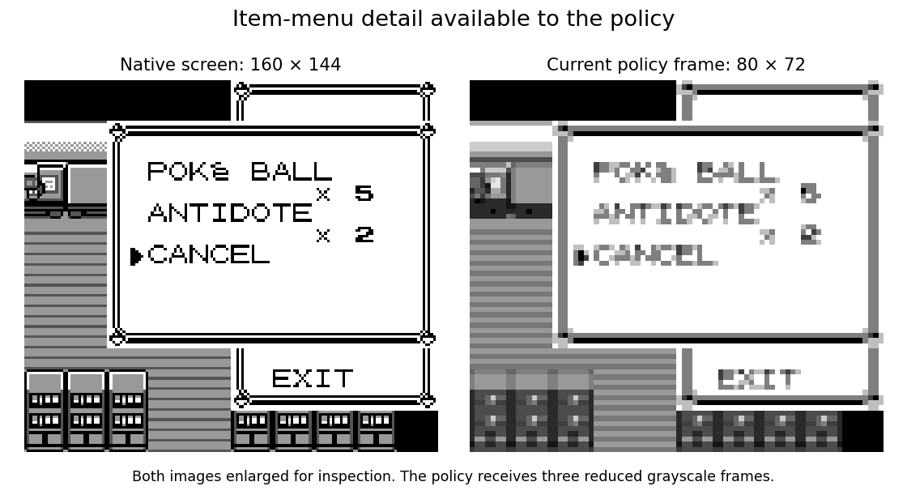
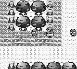
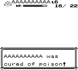

# Antidote behavior, screen resolution, and a poison curriculum fixture

## What the new replay shows

All **three previously diagnosed walking-poison deaths** occurred with antidotes
still in the bag:

| Checkpoint | Evaluation seed | Death action | Antidotes remaining |
|---|---:|---:|---:|
| pixels-ppo-s0-m10 | 1002 | 9,137 | **3** |
| ram-ppo-s0-m10 | 1005 | 13,079 | **2** |
| ram-lstm-s0-m10 | 1005 | 14,396 | **2** |

The pixel policy even collected an extra forest antidote at action 6,797, going
from two to three while standing at `(15,42)` on map 51, beside the hidden item.
It never used those three before the walking-poison wipe. Buying more supplies
would not directly address these three observed deaths.

The same audit found **five successful antidote cures**, all during battles:
four from pixel PPO and one from RAM LSTM. For each, poison cleared while the
Pokémon stayed alive and the antidote count fell by one in the same action.
Two pixel-PPO trainer wipes occurred after both antidotes had been used. Thus
the policies can execute an antidote-use sequence, but they do not reliably treat
poison while walking. This supports a context-dependent recognition/menu-control
problem; it does not prove a particular visual or reward mechanism caused it.

`scripts/replay_inventory.py` adds bag counts and cure/faint events to the recorded
action sequences. **Fifteen episodes were replayed in their original reset order**;
every action's position, battle flag and party matched the recorded trace, and
episode endings/returns matched. Jumping directly to later episodes initially
diverged, so those attempts were rejected and excluded. Preceding episodes are
replayed to reproduce the original emulator reset history. These are diagnostic
replays, not additional independent evaluation trials.

See [the overview](inventory-overview.json) and full inventory summaries for
[pixel PPO](pixels-ppo-s0-m10-inventory.json),
[RAM PPO](ram-ppo-s0-m10-inventory.json), and
[RAM LSTM](ram-lstm-s0-m10-inventory.json).

## Starter and inventory

The current starting save fixes the party to **one level-6 Squirtle, 22/22 HP**,
with **five Poké Balls and two antidotes**. Its internal species ID is `0xB1`,
verified against the pinned
[species constants](https://github.com/pret/pokered/blob/ba9c0568f64ae602fadda577a08c66639f93082a/constants/pokemon_constants.asm).
It starts after the Pokédex/parcel quest. The model does not select a starter.

The same pinned game source contains a visible antidote pickup at `(25,11)` in
[Viridian Forest's object table](https://github.com/pret/pokered/blob/ba9c0568f64ae602fadda577a08c66639f93082a/data/maps/objects/ViridianForest.asm)
and a hidden antidote at `(16,42)` in the
[hidden-item table](https://github.com/pret/pokered/blob/ba9c0568f64ae602fadda577a08c66639f93082a/data/events/hidden_events.asm).
The object source SHA-256 matches the navigation graph's pinned input hash.
The observed inventory increase above supports actual collection of the hidden
pickup in one evaluated trajectory; it is not just theoretical map knowledge.

## Is the text too small?

The native screen is 160×144 pixels (width×height). The policy receives three
80×72 grayscale frames, produced by 2×2 local averaging. A native 8×8 character
cell therefore becomes roughly 4×4 pixels. The current SB3 NatureCNN starts with
an 8×8 kernel and stride 4. Fine text and status details could be harder to learn
at this resolution, but the architecture alone does not prove unreadability.



The label remains recognizable to a human in this capture. That does not establish
that the policy reads it, and successful use could rely on menu position instead
of text recognition. Conversely, the observed low-resolution pixel-policy cures
rule out the blanket claim that the current interface makes antidote use impossible.

The raw [native](bag-native.png) and [policy frame](bag-policy.png) are included.
They were captured from the real starting save by opening START, waiting 24 frames,
selecting ITEM with A, then waiting 24 frames. No RAM editing or OCR supplied
information to the policy.

## A real save for the proposed curriculum

An RNG seed does not force a particular inventory/status configuration. An emulator
**save state**, accompanied by rule-history metadata, does.

We captured a natural state from pixel-PPO evaluation seed 1002 at action 8,688:

- Viridian Forest `(22,40)`, outside battle.
- Level-6 Squirtle, **18/22 HP, poisoned**.
- **Three antidotes**, four Poké Balls, one potion.
- No dead party members; used regions `[1,12,13,51]` carried forward from the monitor.

The raw capture occurred during the battle-exit screen transition. The curriculum
copy advances 168 button-free emulator frames so the overworld is visible, with
HP/status/inventory unchanged. No RAM was edited. A scripted normal-menu sequence
then cured the poison, reduced antidotes from three to two, and retained 18/22 HP.
This verifies the task is feasible, **not that a trained policy succeeds**.




The [curriculum manifest](curriculum_manifest.json) records the save hash, inherited
used regions and the scripted demonstration's actions/wait frames. The state and
compressed replay traces are in the
[artifact release](https://github.com/Phronesis618/67920project/releases/tag/antidote-audit-2026-11-25)
and on Lambda under
`/lambda/nfs/jeff-67920-rl-checkpoints/67920project/diagnostics/antidote-20261125-ordered/curriculum/`.
Recurrent and exploration histories restart for this new staged task. It must be
reported as a curriculum with an explicit initial rule history, not a fresh full-game run.

## Next experiment

Train a short outside-battle poison-cure task from natural saves, keeping actor
inputs as screens/actions. Award a one-time success only for curing a living
poisoned Pokémon with an antidote; death/status clearing on fainting must not count.
Use RAM to score the training task, not as additional actor input. Evaluate on
different HP levels, menu positions and healthy controls so a memorized fixed menu
sequence is not mistaken for general poison management. Then test transfer back
to the original route.

Separately compare the current image stream against native-resolution screens or
a fixed high-resolution screen crop under the same curriculum and reward. A crop
must depend only on screen geometry, not hidden RAM state. Report parameter counts
and throughput: changing image size can also change the CNN's flattened layer and
capacity. No resolution change or poison-curriculum training has been launched yet.

The earlier [checkpoint search](checkpoint_probe_summary.json) has also completed:
80 episodes, 49 forest arrivals, zero Pewter arrivals and zero Brock wins. The
7.86M RAM-PPO snapshot reaches the forest in 18/20 episodes, versus 7/20 for the
final snapshot, but it still does not clear the forest in these probes. This is
exploratory checkpoint selection, not independent evidence of general superiority.

## Reproduce the inventory audit

Download the November 23 forest diagnostic traces and provide the matching ROM
and starting save locally, then run:

```sh
python scripts/replay_inventory.py /path/to/forest-diagnostics/pixels-ppo-s0-m10 \
  --episodes 0 2 --output runs/pixel-antidote-audit
```

The output directory must be new. The script replays all episodes through the
highest requested index in their original order, verifies the original states,
and captures eligible natural poisoned overworld states with their rule metadata.
