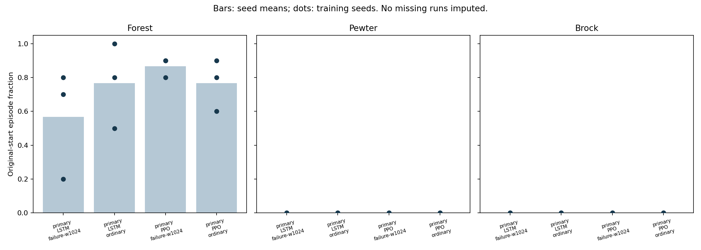

# Completed failure-restart comparison — November 26, 2026

All twelve matched training runs and their evaluations completed successfully:
PPO/LSTM × ordinary/failure starts × three seeds, each receiving 1,048,576 added
actions. All 120 evaluation episodes start from the original post-parcel save.
**None reaches Pewter or beats Brock.** Forest counts below measure arrival, not exit.

| Model / training starts | Forest arrivals | Pokémon deaths | Timeouts |
|---|---:|---:|---:|
| PPO / ordinary | 23/30 | 19 | 7/30 |
| PPO / failure restarts | 26/30 | 12 | 15/30 |
| LSTM / ordinary | 23/30 | 17 | 9/30 |
| LSTM / failure restarts | 17/30 | 6 | 23/30 |

PPO's extra three forest arrivals come entirely from one seed; the other two pairs
tie. LSTM has fewer forest arrivals in all three pairs (-3, -1, -2). Across both
architectures, deaths fall from 36 to 18 while timeouts rise from 16 to 38 (60
episodes per arm). Fewer deaths alone therefore do not establish better play or
poison management; reduced progress/exposure may contribute. Three seeds and ten
episodes per seed limit precision. This comparison does not establish a reliable
full-route benefit from the current failure-restart sampler.

## What the diagnostic replays show

Forty selected episodes were replayed, with all 40 matching their original end
state and return. These repeat existing evaluations; they are not 40 independent
new trials. Eight selected tail videos and complete action/event traces are saved
on persistent Lambda storage and backed up to the Mac.

- 580 actual RUN selections were rejected in trainer battles.
- 771 of 788 wild-battle RUN attempts succeeded; 17 failed.
- Recorded faint causes: 10 trainer battles, 6 walking poison, 6 wild battles.

Repeated trainer RUN selection remains a concrete behavioral problem. These
selected traces do not prove it caused every trainer death or all forest failures.
The diagnostic [counts and video index](diagnostics.json) retain replay provenance.

## The antidote diagnostic learned the small task, with poor route transfer

The single retained PPO half-resolution fine-tune completed 1,048,576 actions.
Its initial/final evaluations give:

| Evaluation | Initial | Fine-tuned |
|---|---:|---:|
| Training-save cures | 1/9 | 9/9 |
| Held-out-save cures | 0/9 | 9/9 |
| Original-route forest arrivals | 3/3 | 0/3 |
| Original-route Pewter/Brock | 0/3 | 0/3 |

The held-out saves vary HP/location but remain a small curated set. Healthy-control
episodes receive no false cure successes in either model; this does not prove
selective item use because the game rejects antidotes on healthy Pokémon. The
three-episode route probe is small, but the drop in forest arrivals warns that
specializing on the menu task can lose navigation behavior. It is not evidence
that antidote learning solved full-route survival. See [full records](cure-evaluation.json).

## Queue decision and preservation

The automated extension did not trigger. PPO improved progress in only one of
three pairs; LSTM improved in none. Of retries originating from wipes/violations,
22/80 PPO and 12/70 LSTM retries failed by the prior failure time, below the 80%
threshold for the earlier-window experiment. These thresholds allocate compute,
not statistical significance. See [decision.json](decision.json).

The main queue finished at **12:29 a.m. Pacific November 26**. Diagnostic replays
and reporting finished at **1:18 a.m.** Both queues are complete; no conditional
training branch was launched. The GPU was idle when checked for this update.
Final Mac backups succeeded at **12:30 a.m.** and **1:19 a.m.**, respectively.
The antidote evaluation, which was written after its original queue paused, was
also pulled to the Mac during this update. Persistent checkpoint storage remains
`/lambda/nfs/jeff-67920-rl-checkpoints/67920project`.

The next evidence-driven priority is trainer-battle decision-making and preserving
navigation while learning survival skills. No new treatment is launched by this
status update. The November 29, 8:59 p.m. Pacific training cutoff remains in place.

## Supporting artifacts

- [Per-seed counts](per-seed.csv), [exact manifests and episode records](evidence.json).
- [Generated detailed report](report.md), [training-distribution curves](training-curves.png).
- [Primary queue status](primary-status.json), [follow-up status](status.json), [backups](backups.json).
- [Presentation outline](presentation-outline.md).

The starter and two initial antidotes are supplied by the start save. Learned
purchasing remains unproven. Actor inputs are screens/actions; the existing
RAM-based route rewards and navigation shaping remain unchanged in the matched
comparison. The cure diagnostic's extra reward is a separate intervention.
