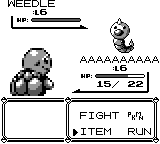
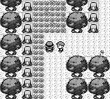

# Why the route runs fail — trace and controlled-branch audit

The optimizer sweep was launched before establishing the failure mechanisms. It
is now paused: the one in-flight PPO job finished, and the remaining training and
evaluation jobs have not started. Its final backup succeeded at 10:57 a.m. Pacific
on November 27. No further learning run was used for this investigation.

This audit covers every action trace in the completed comparison: **240 episodes**
from 24 checkpoints, plus all **2,750 logged terminal training episodes** from the
18 continuations. Repeated checkpoints, training restarts and matched evaluation
seeds mean these are not all independent trials. The audit also reproduces a
natural trainer entry and branches its exact emulator/rule/reward state.

**1. A controlled case identifies combat action selection as a real blocker.**

PPO ordinary seed 0, evaluation seed 6003, enters the first forest trainer at
action 3,389 with a healthy level-6 Squirtle (22/22 HP). To reproduce the emulator
state, we replayed all three preceding episodes and the current prefix, matching
positions, battle flags, rewards, party HP/status and antidote inventory across
**32,365 actions**. Repeating that reconstruction produced the identical snapshot
hash. Both branches below start from the same captured state, including RNG and
rule history.

| Branch after the captured entry | Additional actions | Rejected RUN selections | Result |
|---|---:|---:|---|
| Original recorded policy buttons | 12,995 | 441 | Still in the first trainer battle at the time limit; level 6, 15/22 HP |
| Repeated A button | 290 | 0 | First trainer beaten; level 8, 9/26 HP, poisoned |

The second branch uses the ordinary 24-frame button action. It changes no HP,
party, inventory, opponent, rules, reward, or policy weights. This is a scripted
**diagnostic feasibility check**, not trained-agent performance or a proposed
combat macro. It proves this particular failed encounter was winnable from the
agent's actual state; it does not establish a success rate for other fights.

The game rejects trainer RUN without consuming a combat turn, then displays the
menu again. This explains how a policy can spend thousands of actions in the
same fight without immediately dying. Wild RUN succeeds in **4,618/4,743 attempts
(97.4%)** across these traces; trainer RUN has a very different consequence.
See the pinned game's [RUN handling](https://github.com/pret/pokered/blob/ba9c0568f64ae602fadda577a08c66639f93082a/engine/battle/core.asm).

Original policy at timeout:

Controlled A-button branch after the verified trainer flag changed:

**2. Winning a fight does not solve the subsequent survival problem.**

The observed 88 individual Pokémon faints break down into **35 trainer-battle,
24 wild-battle, and 29 walking-poison faints**. Of those 29 poison faints,
**27 occurred with antidotes still in the bag**. Item supply or purchasing is
therefore not the proximate explanation for those 27 failures.

The policy is not universally incapable of using antidotes: **21 poison-clear
events** coincide within five actions with an antidote inventory decrease. The
problem is unreliable use when needed. Inventory decreases alone are not counted
as cures, since discarding items or transient inventory writes could also reduce
the count. The separate half-resolution cure diagnostic previously reached 9/9
held-out cures, so inability to read the word "Antidote" is not established.

The controlled victory itself leaves Squirtle poisoned at 9 HP with **two
antidotes available**. It demonstrates the sequence of bottlenecks: execute the
fight, then treat status/heal before continuing. Across the evaluated trajectories,
**99/102 trainer entries have only one party member**, and 71/102 enter with that
Pokémon at level 6. Preparation and survival matter for real combat deaths even
though they do not explain the controlled full-health RUN-loop case.

**3. Navigation and episode duration are separate problems from combat.**

Of 240 endings, **120 are timeouts, 85 wipes, and 35 rule violations**. The 120
timeouts end in the overworld in 87 cases, in wild battles in nine, and in trainer
battles in 24. Fifty-six timeout episodes never reached the forest. Thus trainer
RUN loops cannot explain every failure or the replay models' navigation regression.
Only five timeout episodes spend at least 1,000 consecutive overworld actions on
one tile; many others wander, revisit locations or cycle through encounters.

Among 132 forest arrivals, median arrival is action 5,531.5, leaving **10,852.5
actions**. Some arrive very late, but extending the episode limit alone does not
address the rejected RUN selections in the 12,995-action stalled battle above.

Our shortest-path calculation supplies a **reward potential**; it does not choose
the model's buttons. It models static walking distances and excludes battle
duration, trainer sight lines, HP and poison. Its target remains Brock even when
the Pokémon needs recovery. The static graph contains a 216-cost path from the
forest entrance to the Brock goal that avoids the first two trainers' sight
lines, with no extra walking cost. Blocking all three trainers' sight lines
disconnects that path in this graph. This supports two distinct tasks: better
navigation can avoid some fights, while some combat competence is still needed.
This graph calculation is not an emulator-validated traversal or a model of wild
encounter danger. Sight-line inputs come from the pinned
[forest objects](https://github.com/pret/pokered/blob/ba9c0568f64ae602fadda577a08c66639f93082a/data/maps/objects/ViridianForest.asm)
and [trainer headers](https://github.com/pret/pokered/blob/ba9c0568f64ae602fadda577a08c66639f93082a/scripts/ViridianForest.asm).

**4. The victory reward works; delayed credit and missing context remain concerns.**

The controlled win sets the expected trainer flag and produces the existing
**+2 event reward** at action 290 of the branch. Over the same 290-action horizon,
the A-button branch receives +1.546 total reward; the recorded policy receives
-0.470. No victory reward was added for this audit. There is no evidence here
that the agent is unable to win because the environment fails to recognize wins.

The existing reward has no direct enemy-HP/damage or poison-clearing term; level
reward is disabled, and separate death/violation penalties are zero. Battle
progress is mainly credited through a completed trainer event and subsequent
route progress. Antidote use normally changes status without immediately
increasing HP, so its value must be learned through later survival/progress.
The walking potential gives no within-battle progress signal while coordinates
remain fixed. Its discounted telescoping form should not be confused with an
independent time penalty or proof that dying is rewarded.

Actual recorded trainer encounters that exited took **549–8,126 actions**, median
2,144; all 45 lasted longer than the 512-action training rollout. PPO uses
gamma 0.9995 and GAE lambda 0.99. A distant TD residual's direct GAE weight falls
to about 0.0045 after 512 actions and 0.000026 after 1,000. Value bootstrapping can
propagate rewards farther across updates, so these numbers are not a hard limit
on what PPO can learn. They do explain why efficiently completing combat and
having a useful critic are central to credit assignment. The A-button branch
shows the same fight can finish inside one rollout instead of several.

Actor inputs are three grayscale frames and the last three actions. The actor
does not receive RAM battle type, poison status, inventory or encounter history.
The main battle menu does not explicitly label "wild" versus "trainer" after the
intro; useful context may have disappeared from a short frame stack. An LSTM
could remember it, but capacity alone does not show that it learned to do so.
Failure-tail starts can also begin mid-menu with recurrent state reset and no
replayed introduction. These are concrete design concerns, not isolated causal
proof of the replay regression.

**5. What is established, and what is not.**

The battle-control failure, available-but-unused antidotes at most poison faints,
and lack of route progress are directly observed. All 35 illegal-catch endings
are consistent with encounter history: their region was already used in the
starting save or had an earlier wild encounter. Empty new-party slots during
catch animation did not establish false rule terminations. The audit found no
Pewter/Brock milestone in any of the 2,750 logged terminal training episodes;
unfinished final worker episodes are not included in that claim.

We have **not** shown that learning rate is the primary cause, that the LSTM cannot
learn the task, that higher image resolution is required, or that a particular
new reward will fix the problem. The optimizer continuation is paused rather than
being treated as a demonstrated remedy. The observed replay regression is real;
its precise optimization versus state-distribution versus memory mechanism is
still unresolved.

Before another full training comparison, the next work should establish a small
diagnostic set of naturally reached battle/status states and check whether the
learned policy recognizes the context and executes the required menu sequence.
Any proposed change should improve that measured behavior and then preserve
original-route performance. Privileged labels could supervise a learned memory
or auxiliary prediction without becoming actor inputs, but that is a candidate
intervention to justify against these diagnostics, not an established solution.
The controlled A-button sequence is not being inserted into training or reported
as agent performance.

Evidence: [trace summary](trace-summary.json), [240-episode audit](episode-audit.csv),
[exact branch and reward changes](trainer-branch.json), [training counts and graph
paths](training-and-navigation.json), [catch audit](catch-audit.json), [observed
cures](cure-pairing.json), [credit settings](credit-settings.json), and
[paused queue plus backup](queue-state.json). Reproduction scripts are
`scripts/audit_route_failures.py`, `scripts/capture_failed_trainer.py`, and
`scripts/branch_trainer_diagnostic.py`. Raw traces/snapshots remain in the local
and persistent Lambda run directories; no environment or policy code was changed
for this audit.
